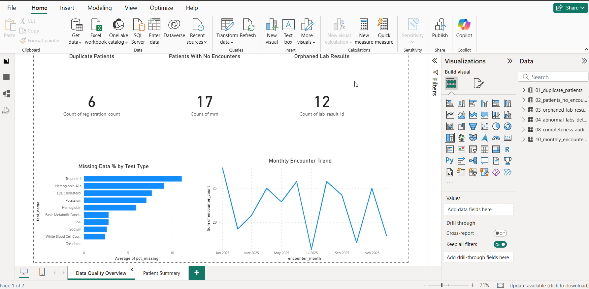
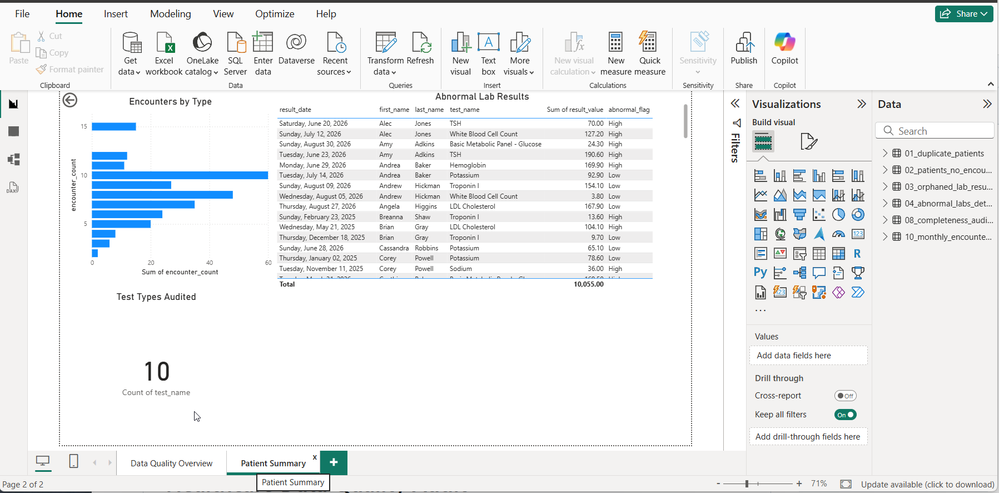
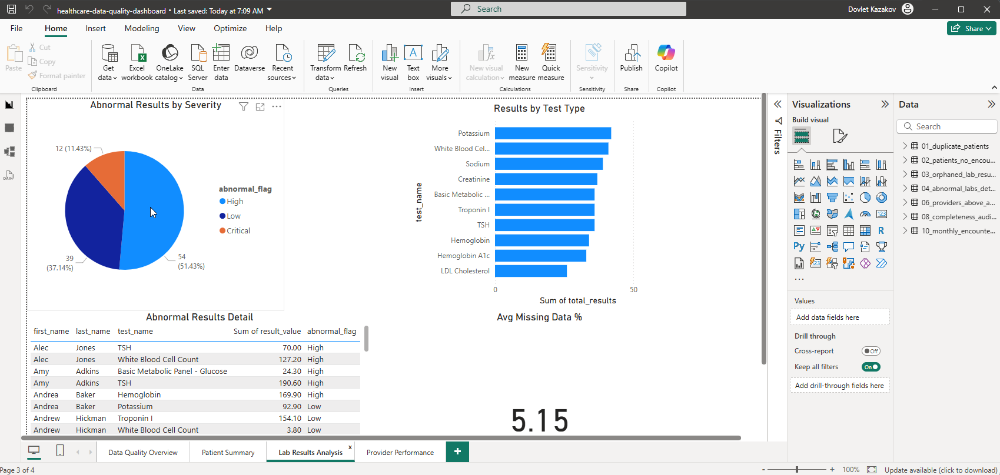
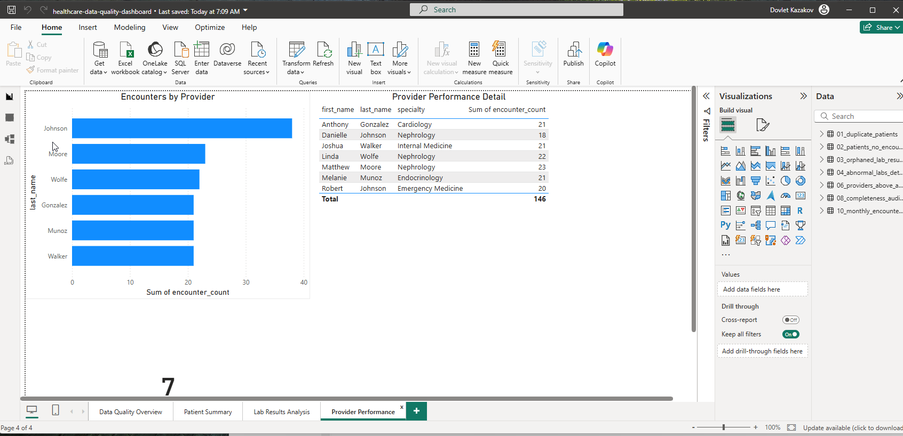

# Healthcare Data Quality Audit | SQL + Power BI

**Healthcare data quality portfolio project** focused on patient registration, encounters, laboratory results, medications, and interoperability-related data validation.

**David Kazakov** | Healthcare Interoperability & Integration Analyst | Senior QA Engineer  
[LinkedIn](https://linkedin.com/in/davidkazakov) | **Email:** [david.kazakov@outlook.com](mailto:david.kazakov@outlook.com)

## Project Navigation

- [Project Overview](#project-overview)
- [Audit Findings](#audit-findings)
- [Case Study: Potential Duplicate Patient Registrations](#case-study-potential-duplicate-patient-registrations)
- [SQL Audit Queries](#sql-audit-queries)
- [Power BI Dashboard](#power-bi-dashboard)
- [Repository Structure](#repository-structure)
- [How to Explore](#how-to-explore)
- [Related HL7/FHIR Project](#related-hl7fhir-project)

## Project Overview

I created this project to demonstrate how SQL and Power BI can identify and communicate healthcare data quality issues. The scenario uses a **synthetic hospital dataset** with intentionally introduced problems resembling issues encountered in patient registration, HL7 ADT/ORU workflows, and downstream clinical reporting.

My professional background includes investigating healthcare interface issues, validating clinical data, and working with interface and development teams. This project applies that data-quality perspective to a standalone SQL audit and reporting exercise.

**Dataset scope**

| Dataset | Records |
|---|---:|
| Patients | 109 |
| Encounters | 268 |
| Laboratory results | 360 |
| Medications | 59 |

**Tools and concepts:** SQL (joins, CTEs, subqueries, window functions, aggregation), Power BI, data quality auditing, referential integrity, patient identifiers/MPI concepts, HL7 v2 (ADT/ORU), FHIR R4 concepts, and interface troubleshooting (Rhapsody, Mirth Connect, InterSystems HealthShare).

> **Scope:** The SQL audit and Power BI dashboard use simulated relational healthcare data. The related HL7/FHIR materials are documented separately; this audit does not claim to ingest live HL7 feeds or operate a production interface engine.

## Audit Findings

Ten SQL queries examine duplicate-registration candidates, missing relationships, date inconsistencies, data completeness, and utilization trends.

| Finding in the simulated dataset | Count / result |
|---|---:|
| Potential duplicate registration matches (same name and DOB) | 6 |
| Patients with no recorded encounters | 17 |
| Lab results with no matching encounter | 12 |
| Medications with an end date before the start date | 1 |
| Patients with no recorded lab activity in the past 90 days | 66 |
| Highest lab-result NULL rate by test type (Troponin I) | 11.1% |

These are **audit flags**, not verified clinical diagnoses or patient-safety events. For example, matching names and birth dates require further identifier and demographic review before records can be classified as true duplicates. Likewise, the absence of recent lab results does not by itself establish that testing was clinically indicated.

## Case Study: Potential Duplicate Patient Registrations

The duplicate-registration audit identified **six potential matches based on name and date of birth**. In a real healthcare environment, these results would require investigation before deciding whether records belong to the same patient.

If a patient does have records under multiple identifiers, their clinical history could be fragmented across charts. To investigate, I would compare medical record numbers and assigning authorities, registration details, encounter history, and available source-system evidence. I would also trace relevant HL7 segments such as **PID** (patient identifiers), **PV1** (visit information), **AL1** (allergies), **DG1** (diagnoses), **ORC/OBR** (orders), and **OBX** (results), depending on the feed.

For interface-related discrepancies, I would review message traces, transformations, ACKs, routing, and error queues in tools such as **Rhapsody, Mirth Connect, or InterSystems HealthShare**, then coordinate with registration, interface, and application teams to validate the root cause and retest the corrected data flow.

**Takeaway:** SQL can identify records requiring investigation; reliable patient matching and remediation require additional source-system and MPI validation. The objective is to find the cause, quantify the affected records, and reduce recurring data quality issues.

## SQL Audit Queries

| # | Audit | SQL technique | Script |
|---|---|---|---|
| 1 | Potential duplicate registrations | `GROUP BY`, `HAVING` | [01_duplicate_patients.sql](sql-queries/01_duplicate_patients.sql) |
| 2 | Patients without encounters | `LEFT JOIN`, `IS NULL` | [02_patients_no_encounters.sql](sql-queries/02_patients_no_encounters.sql) |
| 3 | Orphaned lab results | `LEFT JOIN`, `IS NULL` | [03_orphaned_lab_results.sql](sql-queries/03_orphaned_lab_results.sql) |
| 4 | Abnormal labs with patient/provider detail | Multi-table `JOIN` | [04_abnormal_labs_detail.sql](sql-queries/04_abnormal_labs_detail.sql) |
| 5 | Medication date inconsistencies | `CASE WHEN`, date comparison | [05_medication_date_errors.sql](sql-queries/05_medication_date_errors.sql) |
| 6 | Providers above average encounter volume | Subquery | [06_providers_above_avg_encounters.sql](sql-queries/06_providers_above_avg_encounters.sql) |
| 7 | Patients without recent lab activity | CTE, date functions | [07_patients_no_recent_labs.sql](sql-queries/07_patients_no_recent_labs.sql) |
| 8 | Lab result completeness by test type | Aggregation, conditional counts | [08_completeness_audit_by_test.sql](sql-queries/08_completeness_audit_by_test.sql) |
| 9 | Most recent lab result per patient | `ROW_NUMBER()` | [09_most_recent_lab_per_patient.sql](sql-queries/09_most_recent_lab_per_patient.sql) |
| 10 | Monthly encounter trend | Date grouping | [10_monthly_encounter_trend.sql](sql-queries/10_monthly_encounter_trend.sql) |

Each script includes comments explaining the audit purpose. **Execution environment and reproducible sample data will be documented separately**; some date and aggregation functions are SQL-dialect-specific.

## Power BI Dashboard

The project includes a four-page Power BI report:

1. **Data Quality Overview:** audit metrics, data completeness, and issue counts.
2. **Patient Summary:** patient and encounter activity, demographics, and trends.
3. **Lab Results Analysis:** laboratory activity and abnormal-result patterns.
4. **Provider Performance:** encounter volume and provider-level comparisons.

**Files:** [Power BI report (.pbix)](powerbi/healthcare-data-quality-dashboard.pbix) | [Four-page dashboard PDF](powerbi/healthcare-data-quality-dashboard.pdf)

### Dashboard Screenshots

**1. Data Quality Overview**



**2. Patient Summary**



**3. Lab Results Analysis**



**4. Provider Performance**




## Repository Structure

```text
healthcare_data_portfolio/
├── README.md
├── sql-queries/   # 10 documented SQL audit scripts
├── powerbi/       # .pbix, PDF, and four dashboard screenshots
└── hl7-fhir/      # Separate HL7-to-FHIR project documentation and diagram
```

## How to Explore

1. Start with the [audit findings](#audit-findings) and [duplicate-registration case study](#case-study-potential-duplicate-patient-registrations).
2. Open the [SQL scripts](sql-queries/) to see how each issue is detected.
3. View the [dashboard PDF](powerbi/healthcare-data-quality-dashboard.pdf) or the four screenshots above.
4. Review the [HL7/FHIR project](hl7-fhir/) for the related interoperability context.

**Reproducibility status:** The current repository includes the SQL scripts and Power BI artifacts but does not yet include the underlying synthetic data exports or database-creation instructions. Those will be added in the technical-completeness session.

## Related HL7/FHIR Project

[HL7 v2 to FHIR R4 Integration Pipeline — documentation and architecture diagram](hl7-fhir/)

This related section describes healthcare interoperability concepts and a proposed pipeline. Refer to its own documentation for the specific implementation scope.

## Data Privacy

The project uses **synthetic data only**. No real patient information or protected health information (PHI) is included.
