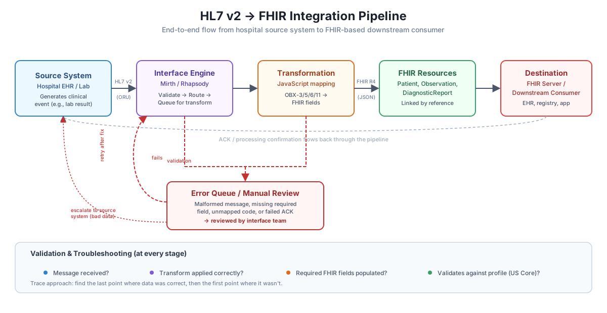

# HL7 v2 to FHIR R4 Integration Pipeline

## Overview

This section documents an **HL7 v2.5 ADT^A01 → FHIR R4** mapping scenario using Mirth Connect concepts. It focuses on patient demographics, visit identifiers, and the relationship between FHIR Patient and Encounter resources.

The original project documentation describes Mirth Connect 4.7.0, JavaScript transformers, and Patient/Encounter mappings as completed. **The repository currently contains documentation and a diagram, but no exported Mirth channel, transformer source code, or executable test evidence.** The examples below illustrate the intended mappings; they are not evidence of a deployed interface.



## Technology and Scope

- **Source:** HL7 v2.5 ADT^A01 admission event
- **Interface engine:** Mirth Connect 4.7.0 (as described in the original project)
- **Transformation approach:** JavaScript mapping concepts
- **Target:** FHIR R4 `Patient` and `Encounter` resources
- **Included:** example message, field-level mapping, illustrative FHIR JSON, validation considerations
- **Not included in this repository:** channel export, executable transformation, live endpoint, or automated tests

## Example Input — Synthetic HL7 ADT^A01

```hl7
MSH|^~\&|HOSPITAL_EHR|HOSP_A|INTERFACE|DEMO|20261012103000||ADT^A01|MSG0001|P|2.5
EVN|A01|20261012103000
PID|1||MRN12345^^^HOSP_A^MR||DOE^JANE||19850314|F
PV1|1|I|WARD1^ROOM12^BED2||||||||||||||||VISIT789
```

All identifiers and demographics above are fictional.

## Field Mapping Reference

| HL7 v2.5 field | Meaning | FHIR R4 destination | Notes |
|---|---|---|---|
| `PID-3` | Patient identifier (MRN and assigning authority) | `Patient.identifier[]` | **Not** `Patient.id`; preserve assigning authority and identifier system |
| `PID-5.1` | Family name | `Patient.name[0].family` | HL7 XPN family-name component |
| `PID-5.2` | Given name | `Patient.name[0].given[0]` | HL7 XPN given-name component |
| `PID-7` | Date of birth | `Patient.birthDate` | Convert `YYYYMMDD` to `YYYY-MM-DD` |
| `PID-8` | Administrative sex | `Patient.gender` | Map HL7 values to FHIR codes; verify local mapping policy |
| `PV1-3` | Assigned patient location | `Encounter.location[].location.reference` | Requires resolution to a FHIR `Location` resource; do not insert raw HL7 location as a reference |
| `PV1-19` | Visit number | `Encounter.identifier[]` | **Not** necessarily `Encounter.id`; use visit identifier and its assigning authority |
| `PV1-2` | Patient class | `Encounter.class` | Map local HL7 class code to an appropriate coding system |
| `PV1` / ADT event | Admission context | `Encounter.status` and `Encounter.subject` | Requires workflow-specific status mapping and Patient reference |

FHIR `Resource.id` is a server-assigned or application-controlled logical resource identifier. Source-system MRNs and visit numbers should normally be represented using `identifier` elements.

## Illustrative FHIR R4 Output

**Patient**

```json
{
  "resourceType": "Patient",
  "identifier": [
    {
      "system": "https://example.org/fhir/sid/hosp-a-mrn",
      "value": "MRN12345"
    }
  ],
  "name": [{"family": "DOE", "given": ["JANE"]}],
  "gender": "female",
  "birthDate": "1985-03-14"
}
```

**Encounter (partial illustration)**

```json
{
  "resourceType": "Encounter",
  "status": "in-progress",
  "class": {
    "system": "http://terminology.hl7.org/CodeSystem/v3-ActCode",
    "code": "IMP",
    "display": "inpatient encounter"
  },
  "identifier": [{
    "system": "https://example.org/fhir/sid/hosp-a-visit",
    "value": "VISIT789"
  }],
  "subject": {"reference": "Patient/example-patient"}
}
```

`Patient/example-patient` is a placeholder reference: an implementation must resolve or create the Patient resource and use its actual logical ID (or use a transaction Bundle with appropriate references). The Encounter example omits location because a `Location` resource has not been resolved. The JSON samples illustrate mapping structure and have **not been validated against a live FHIR server**.

## Validation Checklist

1. Confirm HL7 message type, version, delimiters, and required segments.
2. Verify MRN **and assigning authority** so identical MRNs from different facilities do not collide.
3. Check demographic parsing, dates, administrative-sex code mappings, and null handling.
4. Confirm visit number maps to `Encounter.identifier`, and Patient–Encounter references resolve correctly.
5. Validate JSON structure and FHIR R4 profiles against the target implementation guide when applicable.
6. Review ACKs, engine logs, rejected messages, duplicates, and downstream persistence during end-to-end testing.

## Next Implementation Artifacts (Optional)

To present this as an **executed Mirth Connect integration**, add a sanitized channel export, JavaScript transformer, sample input/output files, and test results. Until those artifacts are available, this section should be described as an interoperability **mapping and architecture demonstration**, not a verified running pipeline.
